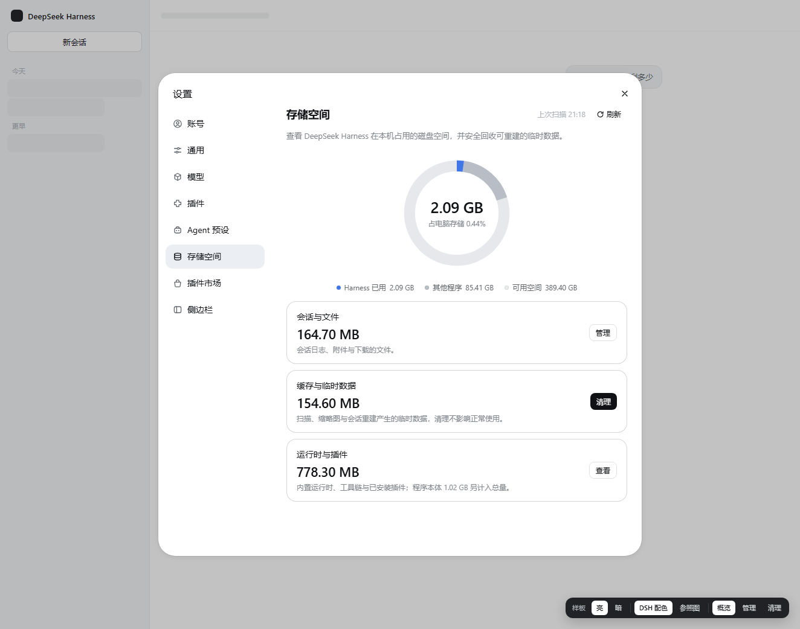

# dsh-storage-insight

**Storage Insight for DeepSeek Harness** — 看一眼 dsh 到底在你机器上占了多少空间，然后只清理**可以重建**的缓存。

A settings page that answers three questions: how much does dsh use, where does it go, and what can I safely reclaim.



## 安装 / Install

**Web 界面**（profile 名通常是 `web`）：

```bash
dsh plugin --profile web add dsh-storage-insight
```

**桌面版**：直接在 **插件** 页安装，不需要命令行。

装完重启 dsh，打开 **设置 → 存储空间**。

> `dsh plugin add` 会自动把包登记进 profile 的 `dsh.profile.bundles`（实测确认），不需要手工改配置。

## 它显示什么

```
总量        1.95 GB      安装 1.02 GB · 临时 0.14 GB
会话与文件   166 MB       会话日志 + 附件
缓存与临时   155 MB       投影缓存、缩略图、临时目录
运行时插件   1.78 GB      内置运行时、工具链、插件依赖、程序本体
占用比例     0.45%       相对整块磁盘
```

- **环形图**：Harness 占用 / 其他程序 / 可用空间
- **会话与文件 → 管理**：按工作区分组、附件按类型、已归档会话（可删除）
- **缓存与临时 → 清理**：先列表预览，确认后才动手

## 只删这些，不删那些

| 会清理 | 条件 |
| --- | --- |
| `%TEMP%\dsh-acl-skill-*`、`dsh-plugin-*` | 24 小时内没改动 |
| `<.dsh>\cache`（缩略图/派生图） | 可再生，删除后自动重建 |
| `<.dsh>\logs` | **仅 7 天前**的文件 |

| 明确不碰 | 原因 |
| --- | --- |
| `sessions/`、`attachments/` | 你的数据，只能通过「管理」里逐条删除已归档会话 |
| `dsh-spill-*`、`dsh-subprocess-*` | 旧会话里"完整输出见 `<路径>`"的引用会失效 |
| `dsh-workspace-changes-*` | 旧会话的变更差异会失效（dsh 自己会回收） |
| 运行时、工具链、插件依赖、程序本体 | 运行必需，删除会直接坏掉 |

删除会话走**系统回收站**（Windows），可从回收站还原；系统回收站不可用时落到 `<.dsh>\.trash\sessions`。

## 安全设计

- 只扫描三个本地根：`DSH_HOME`、安装目录、系统临时目录；**不联网**
- 不跟随符号链接/junction，不越出根目录
- 所有接口要求 `x-storage-insight: 1` 请求头，挡住跨站表单伪造（CSRF）
- 删除只允许**已归档**会话；未归档的会话一律拒绝
- 扫描 15 秒硬上限，超时返回已完成部分并标注"不完整"
- 写 `workspace.json` 前自动备份到 `<.dsh>\.storage-insight\backup\`

## 隐私

- **不联网**：host 侧没有任何网络请求；页面只请求同源相对路径（`storage-insight/api/*`），无外部字体、图片或埋点
- **不上传**：没有遥测、没有错误上报、没有账号关联
- **只读元数据**：扫描读的是文件名、大小、修改时间；会话标题从本地日志的 `session/title` 事件解析
- **接口仅限本机**：`/storage-insight/api/*` 只接受回环地址（127.0.0.1 / ::1）的连接。dsh 若被绑定到 `0.0.0.0` 或放在反向代理后，这些接口直接返回 `403 loopback-only`，避免别人读到你的绝对路径与会话标题
- **防跨站**：浏览器发起的跨站请求一律 403（CSRF），任意网页无法偷偷触发删除
- **写操作有边界**：只写 `workspace.json`（写前自动备份到 `.dsh\.storage-insight\backup\`）与回收站/`.trash`；不碰凭据、不碰配置

## 兼容性

- 需要 dsh Web（0.1.x / 0.2.x），设置面板存在 `settings.section` 槽位
- **扫描和统计在所有平台都可用**；路径在运行时解析（`DSH_HOME` → 安装目录 → 系统临时目录），不写死任何绝对路径
- **系统回收站与"打开所在目录"仅 Windows**：其他平台删除会退到 `<.dsh>\.trash\sessions`，界面文案会相应变化
- 会话标题需要 Node ≥ 22 的 zstd 支持；更老的运行时只会退化为显示短 id，不影响其他功能
- 依赖 dsh 自身的 `workspace.json` 结构（`archivedSessionIds` / `tables.workspaces[].sessionIds`）。dsh 改结构时，归档列表会退化为"只按磁盘目录列出"，不会崩

## 开发

```bash
node test-host.mjs     # host 逻辑（假 ctx 驱动真实扫描）
node test-client.mjs   # client 冒烟（伪造 module loader + React）
node test-render.mjs   # 用真实快照渲染组件（需要 dsh 在跑）
```

## English

Storage Insight adds a **Settings → Storage** page to DeepSeek Harness: a donut of disk usage, three categories (conversations & files, cache & temp, runtime & plugins), a drill-down that lists archived sessions you can delete, and a clean action that only touches rebuildable caches.

Nothing leaves your machine; the plugin scans only `$DSH_HOME`, the dsh install directory and the system temp folder.

## License

MIT
